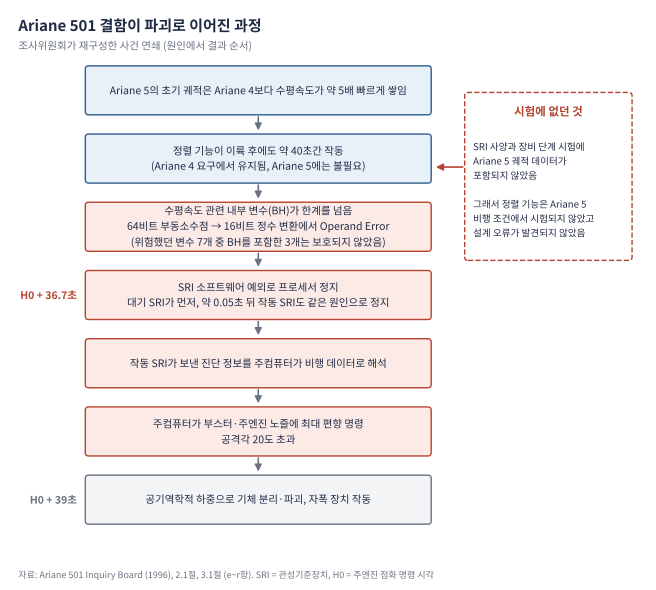
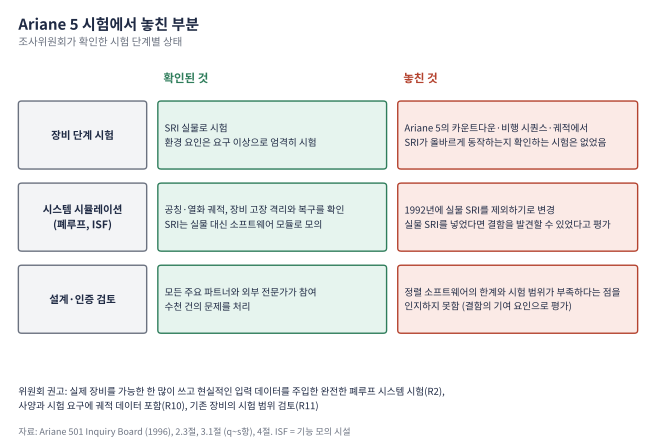
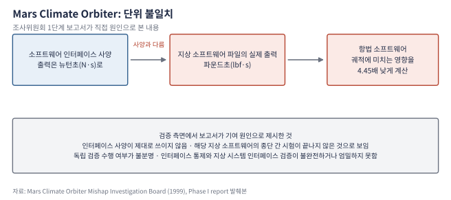
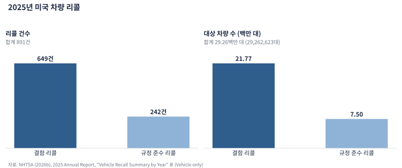
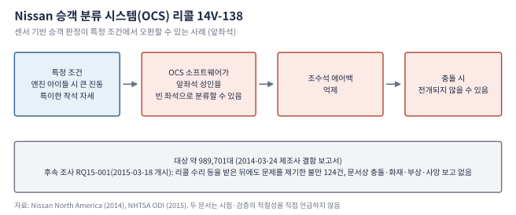
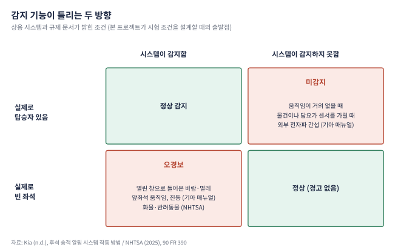

# 검증의 중요성

> **이전 문서** — 원본: Notion "검증의 중요성"(문서 목록 데이터베이스, 마지막 수정 2026-11-11). Notion에서 2026-11-24에 내보내 같은 날 이 저장소로 옮김.
> 이전 시 바꾼 것: 파일 이름 정리, 비공개 Notion 링크 제거(근거 출처는 제목만 남김), 논문·데이터시트에서 가져온 그림은 저작권 때문에 생략(캡션만 유지). 본문 내용은 바꾸지 않음.
> 팀원 실명은 원본에 없었다. 이 문서의 수치·해석은 Notion 시점(2026-11-11)의 것이며 이후 결정(2026-11-13 등)은 `docs/29119/`의 문서가 기준이다.

V모델 순서: 20
근거 출처: Nissan North America — Part 573 Defect Information Report, Recall 14V-138, NHTSA ODI — Recall Query RQ15-001 Investigation Resume (Nissan 14V-138 후속), Ariane 5 Flight 501 Failure: Report by the Inquiry Board, NASA — Mars Climate Orbiter Mishap Investigation Board Phase I Report, NIST Planning Report 02-3 (RTI) — The Economic Impacts of Inadequate Infrastructure for Software Testing, NHTSA — 2025 Annual Report (Annual Recalls Report), Federal Register 90 FR 390 — FMVSS; Occupant Crash Protection, Seat Belt Reminder Systems (최종규칙), Federal Register 91 FR 17144 — Seat Belt Reminder Systems (중간최종규칙), Euro NCAP — Safe Driving Occupant Monitoring Protocol, 기아 2026 타스만 취급설명서 — 후석 승객 알림 시스템 작동 방법, NASA — Systems Engineering Handbook, 5.3 Product Verification
단계: 2 검증의 중요성
마지막 수정일: 2026년 11월 11일 오후 1:28
상태: 검토 완료

<aside>
📌

검증의 의미와 사례를 바탕으로, 기능의 작동 여부를 넘어 요구사항 충족을 증거로 설명해야 하는 이유를 정리한 문서임. 1차 수정일: 2026년 11월 11일. 본문 인용과 참고문헌은 APA 7판을 적용함.

</aside>

## 1. 검증은 무엇을 확인하는 과정인가

NASA는 검증(Verification)을 시스템과 관련 하드웨어·소프트웨어가 명시된 요구사항을 만족하는지 시험, 분석, 검사 또는 시연으로 확인하는 과정으로 설명함. 또한 검증 보고서에는 대상 요구사항과 추적성, 적용한 방법과 조건, 결과 및 이상사항 등을 포함하도록 설명함(National Aeronautics and Space Administration [NASA], 2023).

이를 본 프로젝트에 적용하면, “감지 기능이 한 번 작동하였음”과 “정해진 요구사항을 만족하였음”은 서로 다른 수준의 설명임. 예를 들어 사람이 있는 한 상황에서 알림이 발생하였더라도, 사람이 없는 상황의 오감지나 입력 조건이 바뀌었을 때의 판단까지 확인한 것은 아님.

따라서 본 프로젝트에서는 **무엇을 만족해야 하는지 정하고, 어떤 조건에서 확인하였는지와 실제 결과를 연결하여 판단의 근거를 남기는 것**을 검증의 핵심으로 삼음. 다음 사례들은 시험 조건, 구성요소 간 연결, 감지 판단을 각각 확인해야 하는 이유를 보여 줌.

## 2. 사고 사례에서 확인한 검증의 역할

### 2.1 Ariane 5: 실제 운용 조건을 대표하는 시험이 필요함

1996년 Ariane 5의 첫 비행은 관성기준장치(Inertial Reference System, SRI)의 소프트웨어 예외로 유도·자세 정보가 상실되면서 실패하였음. 수평속도와 관련된 내부 변수를 64비트 부동소수점에서 16비트 정수로 변환할 때 허용 범위를 초과하였고, 이후 진단 정보가 비행 데이터로 해석되어 잘못된 제어 명령으로 이어졌음(Ariane 501 Inquiry Board, 1996).

그림 관련 근거: Ariane 501 Inquiry Board (1996).

조사위원회는 장비 사양과 시험에 Ariane 5의 궤적 데이터가 충분히 반영되지 않았으며, 시스템 시뮬레이션에서도 실제 SRI 또는 그 상세 모의를 포함하지 않은 점을 지적하였음. 권고에는 가능한 한 실제 장비를 포함하고 현실적인 입력 데이터를 주입하는 폐루프 시스템 시험 등이 제시되었음(Ariane 501 Inquiry Board, 1996).

이 사례에서 도출한 검증의 교훈은 **시험을 수행했다는 사실만으로 충분하지 않으며, 시험 입력과 구성이 확인하려는 운용 조건을 대표해야 한다는 것**임. 본 프로젝트도 센서 모델과 입력에 어떤 조건을 반영하였는지 명시하고, 그 조건 안에서 결과를 해석하는 원칙을 적용함.

### 2.2 Mars Climate Orbiter: 구성요소 사이의 데이터 전달도 확인해야 함

1999년 Mars Climate Orbiter 사고조사 보고서는 지상 소프트웨어가 인터페이스 사양의 뉴턴초(N·s) 대신 파운드힘초(lbf·s) 단위로 데이터를 출력한 것을 직접 원인으로 제시하였음. 또한 인터페이스 사양의 부적절한 사용, 종단 간 시험이 완료되지 않은 것으로 보이는 점, 인터페이스 검증의 불완전성 등을 지적하였음(Mars Climate Orbiter Mishap Investigation Board, 1999).

이 사례에서 도출한 교훈은 **각 구성요소의 기능뿐 아니라, 출력 데이터가 다음 구성요소에서 의도한 의미로 해석되는지도 검증해야 한다는 것**임. 본 프로젝트에서는 센서 모델의 출력이 판단 로직의 입력으로 전달되는 과정에서 거리 단위, 입력값의 의미와 처리 기준을 일치시키는 원칙으로 연결함.

### 2.3 검증은 고장 이후의 비용과도 관련됨

NIST가 의뢰한 2002년 RTI 보고서는 미국의 불충분한 소프트웨어 시험 인프라로 발생하는 연간 비용을 약 595억 달러로, 실현 가능한 시험 인프라 개선을 통한 비용 감소 가능액을 약 222억 달러로 추정하였음. 이는 두 산업 분야의 조사 결과를 다른 산업으로 외삽한 당시 미국 경제에 관한 추정임(Research Triangle Institute, 2002).

이 자료는 검증의 경제적 의미를 설명하는 보조 근거로 활용함. 본 프로젝트에서는 비용 절감액을 계산하기보다, 시험에서 확인한 문제와 판단 근거를 기록하여 이후 로직 수정과 재시험에 활용하는 데 중점을 둠.

## 3. 센서 기반 판단 기능에서 검증이 중요한 이유

### 3.1 출고 이후에도 결함과 기준 부적합에 대한 시정이 이루어짐

NHTSA의 2025년 연간 리콜 보고서에 따르면 미국의 차량 리콜은 891건, 대상 차량은 29,262,623대였음. 결함 리콜은 649건, 기준 부적합에 따른 리콜은 242건으로 집계되었음(National Highway Traffic Safety Administration [NHTSA], 2026b).

이 통계는 출고 후 시정의 규모를 보여 주는 배경 자료임. 개별 리콜의 검증 적절성은 원인 자료를 통해 별도로 판단해야 하므로, 여기서는 아래의 승객 분류 시스템 사례를 통해 센서 기반 판단의 문제를 구체적으로 살펴봄.

### 3.2 Nissan 사례: 측정값을 해석하는 판단이 안전 기능에 영향을 줌

Nissan의 2014년 결함 보고서는 약 989,701대를 대상으로, 특정 조건에서 승객 분류 시스템(Occupant Classification System, OCS)이 앞좌석 성인을 빈 좌석으로 분류할 수 있다고 설명하였음. 빈 좌석에 사람이 앉는 시점의 높은 공회전 진동이나 특이한 착석 자세 등이 관련 조건으로 제시되었으며, 오분류가 지속되면 조수석 에어백이 전개되지 않을 수 있었음(Nissan North America, 2014).

2015년 NHTSA 결함조사국의 조사 개시 문서는 리콜 수리 또는 다른 OCS 관련 수리 이후에도 문제가 있다는 불만 124건을 접수하고, 소프트웨어 업데이트의 효과 등을 조사하기 시작하였다고 설명함(National Highway Traffic Safety Administration, Office of Defects Investigation [NHTSA ODI], 2015).

그림 관련 근거: Nissan North America (2014) 및 NHTSA ODI (2015). 124건은 조사 개시 문서의 불만 건수임.

이 사례는 검증 부족을 원인으로 단정하기 위한 사례가 아니라, **센서 입력으로부터 도출한 점유 판단이 조건에 따라 잘못될 수 있고 그 결과가 후속 안전 기능에 영향을 줄 수 있음을 보여 주는 사례**로 활용함. 본 프로젝트에서는 센서 모델의 거리 출력과 승객 존재 판단 결과를 구분하여 평가하는 원칙으로 연결함.

### 3.3 미감지와 오감지를 함께 평가해야 함

NHTSA(2025)는 후석 안전벨트 경고 시스템에서 센서 한계와 화물·반려동물 등 후석 사용 상황에 따른 오경고 가능성을 논의하였음. 기아 취급설명서도 움직임 기반 2차 후석 승객 알림에 대해 움직임이 적거나 물건이 센서를 가리는 경우의 미감지 가능성과, 차량 흔들림이나 물건의 움직임 등에 따른 의도치 않은 알림 가능성을 설명하고 있음. 가림 사례에는 금속이 포함된 섬유 제품(예: 담요)에 탑승자가 가려지는 조건이 포함됨(Kia, n.d.).

이 자료에서 도출한 교훈은 **대상이 있을 때 감지하는 능력과 대상이 없을 때 잘못 판단하지 않는 능력을 함께 확인해야 한다는 것**임. 이에 따라 본 프로젝트는 승객이 있는 조건의 미감지와 승객이 없는 조건의 오감지를 구분하여 결과를 정리하는 방향을 채택함. 상용 시스템의 사례는 이러한 평가 관점을 뒷받침하는 근거로 활용하고, HC-SR04 모델에 적용할 구체적인 입력 조건은 센서 사양 조사와 시험 설계에서 정의함.

## 4. 검증이 제공해야 할 증거

안전벨트 경고에 관한 NHTSA의 2026년 중간최종규칙은 후석 점유 시험의 대상으로 6세 어린이 더미 이상 크기의 시험 장치 또는 체중 21 kg·신장 114 cm 이상의 사람을 제시함(NHTSA, 2026a). Euro NCAP(2026)은 차량에 남겨진 어린이를 감지한 잠금 상황에서 경고 개시까지 최대 15초의 지연을 허용하는 등 조건과 기대 동작을 구체적으로 제시함.

이 자료들은 서로 다른 기능을 평가하지만, **평가 대상·조건·기대 동작을 정해야 결과를 판정할 수 있다는 점**을 보여 줌. 본 프로젝트에서는 이러한 평가 구조를 참고하여 아래 항목을 연결한 검증 기록을 작성함. 개별 수치의 적용 여부는 요구사항·시험 설계 단계에서 프로젝트 목적과 대상에 맞추어 정함.

| 확인할 항목 | 본 프로젝트에서 남길 증거 |
| --- | --- |
| 무엇을 만족해야 하는가 | 승객 감지 판단의 요구사항과 판정 기준 |
| 무엇을 대상으로 확인하였는가 | 센서 모델의 가정, 판단 로직 및 버전 |
| 어떤 조건에서 확인하였는가 | 입력 조건, 시험 절차, 예상 결과 |
| 실행 결과는 어떠하였는가 | 실제 출력, 요구사항별 충족 여부, 미감지·오감지 |
| 결과로 어디까지 설명할 수 있는가 | 확인한 동작 범위와 실제 센서·차량에서 추가 확인할 항목 |

이 표는 문헌의 평가 구조와 앞선 사례에서 도출한 원칙을 본 프로젝트의 작업 항목으로 정리한 것임. 이를 통해 결과가 예상과 다를 때도 해당 입력, 판단 과정과 요구사항을 추적하여 원인을 분석할 수 있도록 함.

## 5. 결론: 요구사항 충족을 설명할 수 있는 결과를 남김

검증이 중요한 이유는 기능의 작동 여부만으로는 다양한 조건에서의 요구사항 충족을 설명하기 어렵기 때문임. 앞선 사례에서는 실제 운용 조건을 대표하는 시험, 구성요소 사이의 데이터 전달 확인, 조건별 판단 결과 평가의 필요성을 확인하였음.

이에 따라 본 프로젝트는 **HC-SR04의 특성을 참고한 센서 모델과 승객 감지 판단 로직을 구성하고, 소프트웨어 인 더 루프(Software-in-the-Loop, SIL) 시험에서 요구사항·시험 조건·판정 기준·실행 결과를 연결하여 기록함.** 최종적으로 설정한 모델과 입력 조건에서 요구사항이 충족되는지, 어떤 조건에서 미감지나 오감지가 발생하는지 설명하는 검증 보고서를 작성함.

이 과정의 핵심 성과는 **판단 결과를 신뢰할 수 있는 범위와 그 근거를 제시하는 것**임. 실제 센서 및 차량에서 추가 확인해야 할 항목도 함께 정리하여, SIL 결과로 설명할 수 있는 범위를 명확히 함.

## 참고문헌

Ariane 501 Inquiry Board. (1996, July 19). *Ariane 5 flight 501 failure: Report by the Inquiry Board*. European Space Agency. [https://esamultimedia.esa.int/docs/esa-x-1819eng.pdf](https://esamultimedia.esa.int/docs/esa-x-1819eng.pdf)

Euro NCAP. (2026). *Safe driving occupant monitoring protocol* (Version 1.2). [https://cdn.euroncap.com/cars/assets/Euro_NCAP_Protocol_Safe_Driving_Occupant_Monitoring_v1_2_aebbc7361f.pdf](https://cdn.euroncap.com/cars/assets/Euro_NCAP_Protocol_Safe_Driving_Occupant_Monitoring_v1_2_aebbc7361f.pdf)

Kia. (n.d.). 후석 승객 알림 시스템 작동 방법. *2026 타스만 취급설명서*. [https://ownersmanual.kia.com/full_webhelp/TK1/2026/ko_KR/topics/t00375.html](https://ownersmanual.kia.com/full_webhelp/TK1/2026/ko_KR/topics/t00375.html)

Mars Climate Orbiter Mishap Investigation Board. (1999, November 10). *Mars Climate Orbiter Mishap Investigation Board phase I report*. National Aeronautics and Space Administration. [https://llis.nasa.gov/llis_lib/pdf/1009464main1_0641-mr.pdf](https://llis.nasa.gov/llis_lib/pdf/1009464main1_0641-mr.pdf)

National Aeronautics and Space Administration. (2023, September 29). *5.3 Product verification*. [https://www.nasa.gov/reference/5-3-product-verification/](https://www.nasa.gov/reference/5-3-product-verification/)

National Highway Traffic Safety Administration. (2025, January 3). Federal motor vehicle safety standards; Occupant crash protection, seat belt reminder systems, controls and displays (Docket No. NHTSA-2024-0071). *Federal Register, 90*(2), 390–468. [https://www.govinfo.gov/content/pkg/FR-2025-01-03/pdf/2024-30340.pdf](https://www.govinfo.gov/content/pkg/FR-2025-01-03/pdf/2024-30340.pdf)

National Highway Traffic Safety Administration. (2026a, April 6). Federal motor vehicle safety standards; Occupant crash protection, seat belt reminder systems (Docket No. NHTSA-2026-0727). *Federal Register, 91*(65), 17144–17159. [https://www.govinfo.gov/content/pkg/FR-2026-04-06/pdf/2026-06614.pdf](https://www.govinfo.gov/content/pkg/FR-2026-04-06/pdf/2026-06614.pdf)

National Highway Traffic Safety Administration. (2026b, March). *NHTSA 2025 annual report*. [https://www.nhtsa.gov/sites/nhtsa.gov/files/2026-03/2025-annual-recalls-report.pdf](https://www.nhtsa.gov/sites/nhtsa.gov/files/2026-03/2025-annual-recalls-report.pdf)

National Highway Traffic Safety Administration, Office of Defects Investigation. (2015, March 18). *Recall query RQ15-001: Investigation resume*. [https://static.nhtsa.gov/odi/inv/2015/INOA-RQ15001-2804.PDF](https://static.nhtsa.gov/odi/inv/2015/INOA-RQ15001-2804.PDF)

Nissan North America. (2014, March 24). *Part 573 defect information report: Recall 14V-138*. National Highway Traffic Safety Administration. [https://static.nhtsa.gov/odi/rcl/2014/RCDNN-14V138-1942P.pdf](https://static.nhtsa.gov/odi/rcl/2014/RCDNN-14V138-1942P.pdf)

Research Triangle Institute. (2002). *The economic impacts of inadequate infrastructure for software testing* (NIST Planning Report 02-3). National Institute of Standards and Technology. [https://www.nist.gov/document/report02-3pdf](https://www.nist.gov/document/report02-3pdf)