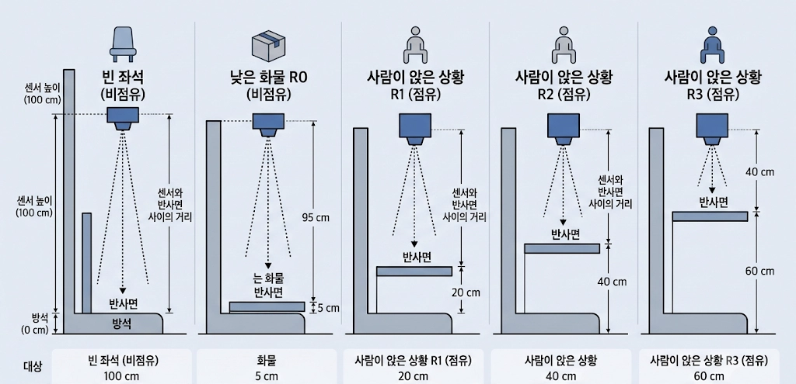
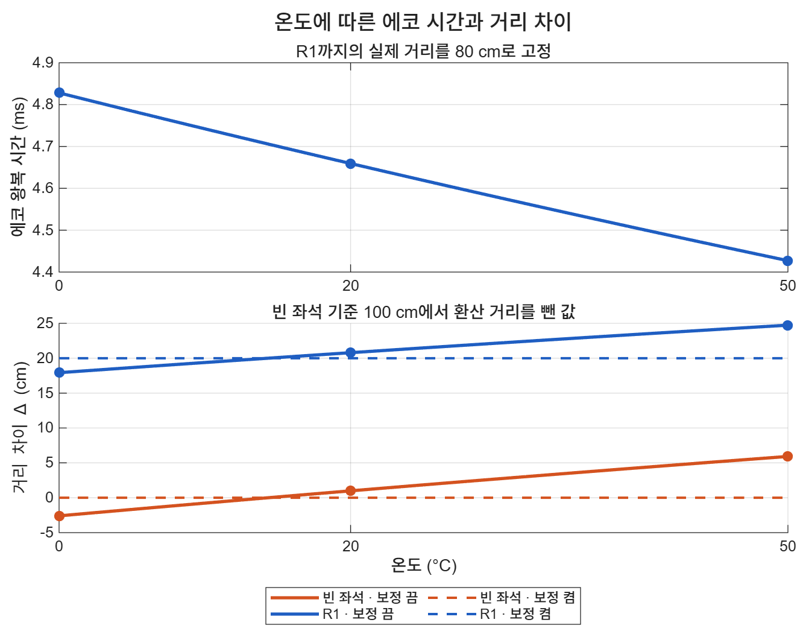
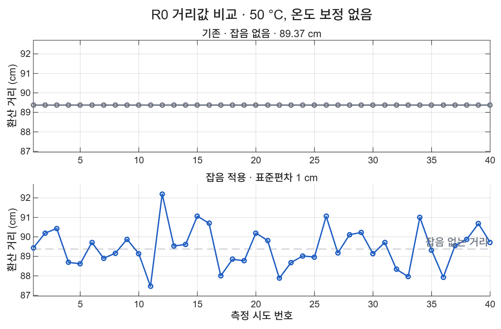
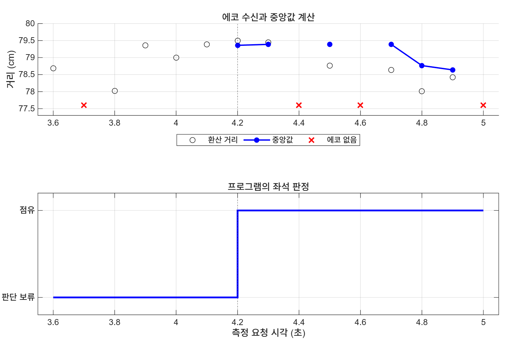
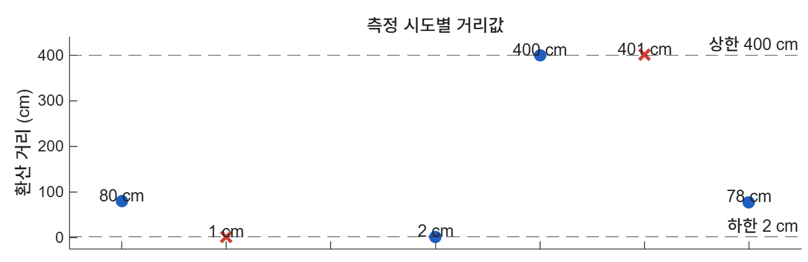
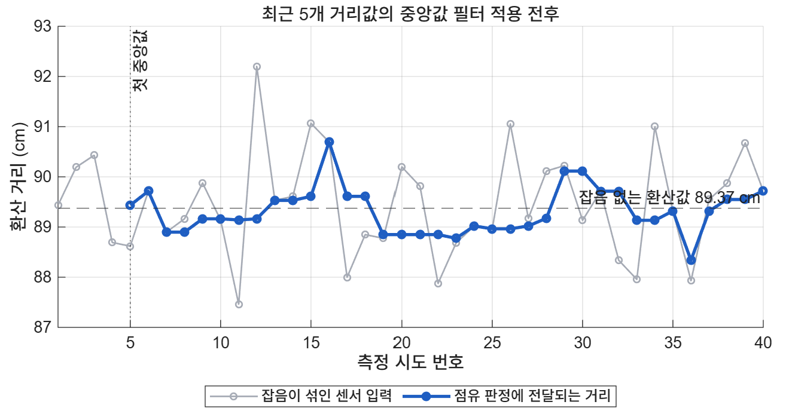
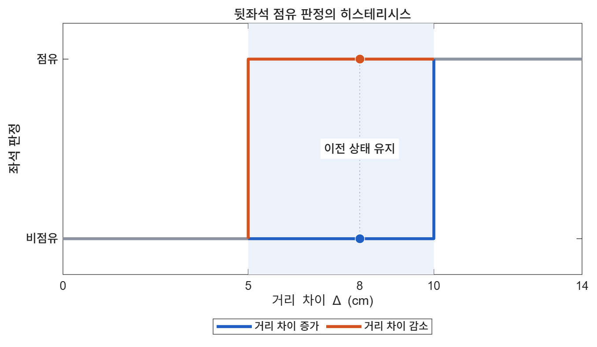
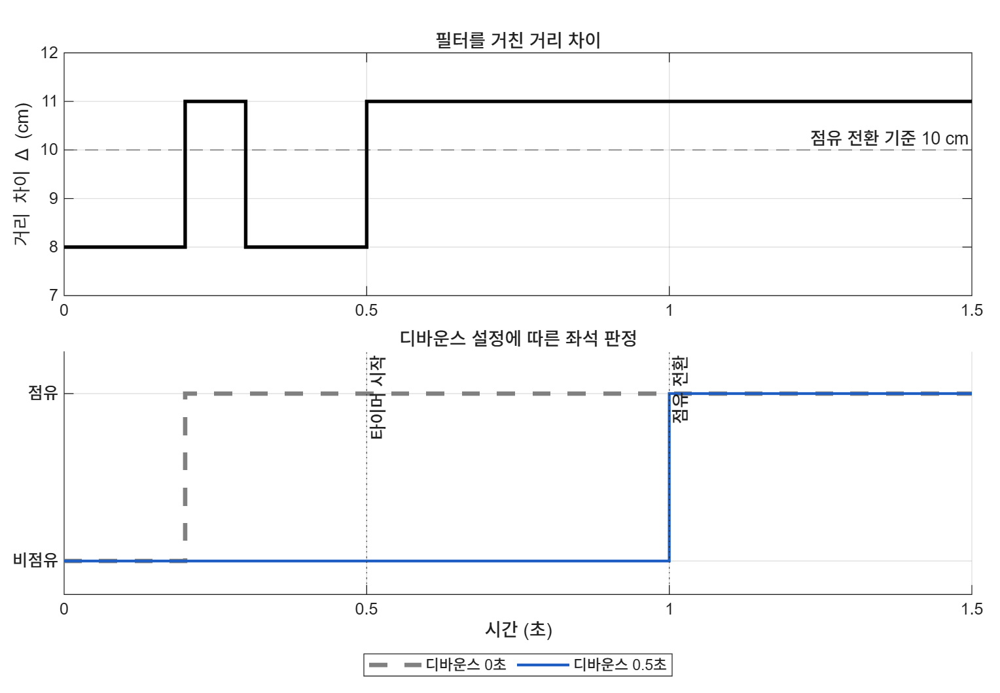
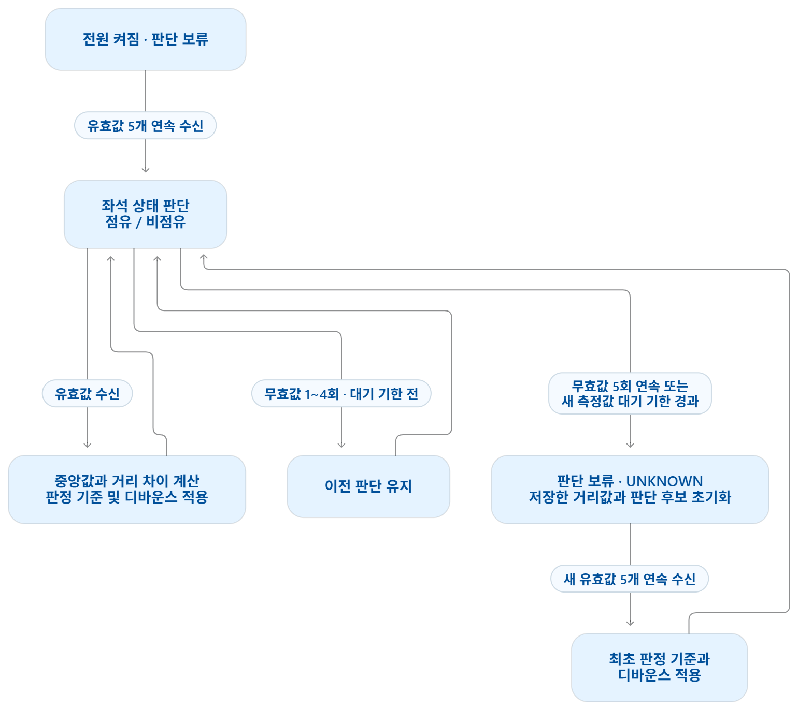

# SIL 설계·결과

> **이전 문서** — 원본: Notion "SIL 설계·결과"(문서 목록 데이터베이스, 마지막 수정 2026-11-11). Notion에서 2026-11-24에 내보내 같은 날 이 저장소로 옮김.
> 이전 시 바꾼 것: 파일 이름 정리, 비공개 Notion 링크 제거(근거 출처는 제목만 남김), 논문·데이터시트에서 가져온 그림은 저작권 때문에 생략(캡션만 유지). 본문 내용은 바꾸지 않음.
> 팀원 실명은 원본에 없었다. 이 문서의 수치·해석은 Notion 시점(2026-11-11)의 것이며 이후 결정(2026-11-13 등)은 `docs/29119/`의 문서가 기준이다.


V모델 순서: 70
단계: 6 SIL 구축·실행
마지막 수정일: 2026년 11월 11일 오후 2:27
상태: 초안

<aside>
📌

초음파 센서 HC-SR04 한 개로 뒷좌석에 사람이 앉았는지 판단하는 프로그램을 만들었음. 가상 센서 입력으로 프로그램을 시험하는 SIL(Software-in-the-Loop)을 구성하고, 예비시험 P-01~P-08을 실행하였음. 이 문서는 「요구사항·시험 설계」 v0.4.1과 예비시험 결과표를 바탕으로 작성한 초안 v0.3임. 본시험에 쓸 설정과 판정 기준은 아직 정하는 중임.

</aside>

## 1. SIL 구성과 실행 환경

### 1.1 무엇을 어떻게 시험하였는가

먼저 빈 좌석, 사람을 가정한 반사면, 가방을 가정한 반사면 등의 시험 상황을 정하였음. 그 상황에서 센서가 보낼 값을 컴퓨터로 만들어 판단 프로그램에 넣고, 결과가 미리 정한 정답과 맞는지 확인하였음.

| 순서 | 하는 일 | 5단계 문서의 관련 내용 |
| --- | --- | --- |
| 1. 시험 상황과 정답 정하기 | 대상과 온도, 착석·이석 시점을 정함. 사람이 있다고 설정한 구간에는 정답을 ‘점유’로 미리 붙임. | 4·9절, P-01~P-08 |
| 2. 센서 입력 만들기 | 센서에서 대상까지의 거리로 초음파 왕복 시간을 계산함. 조건에 따라 거리값을 흔들리게 하거나 초음파가 돌아오지 않는 상황을 만듦. | 4·8절 |
| 3. 자리 상태 판단하기 | 거리값을 골라 다듬고, 사람이 있는지 없는지 판단함. 센서값을 충분히 받지 못하면 판단을 보류함. | SR-05~SR-13 |
| 4. 시험하고 기록하기 | 조건과 시드를 바꿔 반복 실행함. 입력·출력·정답을 저장하고, 잘못 판단한 횟수와 응답 시간을 계산함. | 9절, SR-02~SR-04·SR-14 |

이 문서와 결과표에서 OCCUPIED는 ‘사람이 앉아 있음(점유)’, UNOCCUPIED는 ‘사람이 앉아 있지 않음(비점유)’, UNKNOWN은 ‘판단 보류’를 뜻함. 가방이 놓인 자리의 정답은 비점유로 정하였음.

### 1.2 실행 환경과 실행 방법

예비시험은 Python으로 실행하였음. 사용한 버전은 Python 3.13.18과 NumPy 2.5.3임. NumPy는 시험에 넣을 무작위 잡음과 에코 손실을 만드는 데 사용하였음. 같은 무작위 입력을 다시 만들 수 있도록 시작값인 ‘시드’를 기록하였음. 난수 생성에 사용한 함수는 9.1절에 정리하였음.

Claude가 제공한 `sil_prelim_v0.1.zip`을 풀고, 압축 안의 `sil_prelim` 폴더에서 아래 명령을 순서대로 실행하였음.

```bash
python3 run_prelim.py results
python3 make_report.py results
```

1. 첫 번째 명령은 예비시험을 실행하고, 시험 조건과 센서 입력 및 판단 결과를 `results` 폴더에 저장함.
2. 두 번째 명령은 저장된 기록을 읽고, 각 시험의 기대 결과와 실제 결과를 비교한 결과표를 만듦.

Claude가 같은 조건과 시드로 시험을 다시 실행했을 때 결과 파일의 내용이 모두 같았다고 보고하였음. 이 문서는 요구사항 문서와 예비시험 결과표(`report.md`)를 바탕으로 작성하였음. 원본 ZIP에서 코드 파일과 저장된 시험 기록을 확인하였음. 함수 이름과 줄 번호는 9.1절, 시험 기록을 찾는 방법은 9.3절에 정리하였음.

### 1.3 AI 활용과 작업 분담

프로젝트 팀은 시험할 조건과 기대 결과를 정하였음. Claude의 도움을 받아 Python 코드를 만들고 예비시험 P-01~P-08을 실행하였음. ChatGPT는 요구사항 문서와 예비시험 결과표([report.md](http://report.md))를 읽고, 시험 방법과 결과를 이 문서에 정리하였음.

## 2. 가상 센서 입력을 만드는 방법

### 2.1 센서와 대상의 위치

예비시험에서는 센서가 방석 위 100 cm에서 아래를 향한다고 가정하였음. 사람이나 화물 대신 센서 바로 아래에 높이가 다른 평평한 면을 놓고, 그 면에서 초음파가 돌아오는 것으로 단순화하였음. 센서 높이에서 반사면 높이를 빼면 센서와 대상 사이의 거리임.



| 대상 | 정답 | 방석에서 반사면까지의 높이 | 센서에서 반사면까지의 거리 |
| --- | --- | --- | --- |
| 빈 좌석 | 비점유 | 0 cm | 100 cm |
| 낮은 화물 R0 | 비점유 | 5 cm | 95 cm |
| 사람이 앉은 상황 R1 | 점유 | 20 cm | 80 cm |
| 사람이 앉은 상황 R2 | 점유 | 40 cm | 60 cm |
| 사람이 앉은 상황 R3 | 점유 | 60 cm | 40 cm |

위 표의 센서 높이 100 cm와 반사면 높이 5·20·40·60 cm는 예비시험에서 프로그램의 동작을 확인하기 위해 정한 가정값임. 예비시험을 마친 뒤, 본시험에서 사용할 반사면 높이의 근거를 마련하기 위해 더미와 사람의 앉은키 자료를 찾아 보완하였음.

- **O-A · 6세 더미.** Hybrid III 6세 더미의 앉은키는 63.5 cm임. 센서가 정수리를 바로 내려다보는 가상 조건에서는 이 값을 반사면 높이로 사용할 수 있음. 머리 너비 약 14.2 cm와 앞뒤 길이 약 18.0 cm는 반사면 크기를 정할 때 참고할 수 있음. [NHTSA 논문 부록 Table A3](https://www-nrd.nhtsa.dot.gov/pdf/esv/esv16/98s7o01.pdf) · [Humanetics 제품 사양](https://www.humaneticsgroup.com/products/anthropomorphic-test-devices/child/hybrid-iii-child-6-year-old)
- **O-B · 체중 21 kg 이상, 키 114 cm 이상인 사람.** NHTSA가 제시한 수치는 체중과 서 있는 키 기준임. Hawkes 외(2020)의 미국 아동 연구에서 6.5세 집단의 평균 앉은키는 약 62.7~63.3 cm였음. 이 값은 아동의 참고 치수로 사용하고, 키와 체중 조건을 모두 만족하는 실제 대상의 거리는 시험 자세에서 측정해 정함. [NHTSA 규칙](https://www.govinfo.gov/content/pkg/FR-2026-04-06/pdf/2026-06614.pdf) · [Hawkes 외(2020) 앉은키 자료](https://pmc.ncbi.nlm.nih.gov/articles/PMC7452688/)
- **O-C · 성인.** Hybrid III 50백분위 남성 더미의 앉은키 88.39 cm를 성인 더미의 가상 조건에 참고할 수 있음. 실제 성인을 시험 대상으로 정하면 앉은 자세에서 센서가 향하는 부위까지의 거리를 측정함. [Humanetics 제품 사양](https://www.humaneticsgroup.com/products/anthropomorphic-test-devices/frontal-impact/hybrid-iii-50th-male/hybrid-iii-50th-male) · [사이즈코리아 인체치수 검색](https://sizekorea.kr/human-meas-search/human-data-search/meas-count)

예비 설정의 100 cm를 사용하고 센서가 정수리 바로 위에 있다고 가정하면, 센서에서 정수리까지의 거리는 6세 더미에서 36.5 cm, 성인 더미에서 11.61 cm로 계산됨. 성인 더미의 계산값은 기존 시험 거리 범위 25~200 cm보다 가까움. 본시험 전에는 센서를 달 위치에서 빈 좌석과 대상까지의 거리를 재고, 실제 배치와 시험 거리 범위를 확인한 뒤 입력값을 정함. 결과표에는 문헌 치수로 계산한 값과 시험 배치에서 직접 잰 값을 구분해 기록함.

### 2.2 온도에 따라 거리값이 달라지는 이유

초음파 센서는 소리를 보내고 다시 돌아올 때까지 걸린 시간으로 거리를 구함. 온도가 달라지면 소리의 속도가 바뀌므로, 대상이 같은 자리에 있어도 왕복 시간은 달라짐.

1. 가상 환경에서는 온도 T(°C)에서의 소리 속도를 c(T) = 331.4 + 0.6T(m/s)로 계산함. 센서와 대상 사이 거리의 두 배를 이 속도로 나누어 왕복 시간을 구함.
2. 판단 프로그램은 왕복 시간에 소리 속도를 곱하고 2로 나누어 거리로 바꿈. 온도 보정을 끈 경우 340 m/s를 쓰고, 켠 경우 입력된 온도로 속도를 다시 계산해 사용함.
3. 빈 좌석 기준 거리(d_empty, 예비 설정 100 cm)에서 최근 거리값의 중앙값(d_med)을 뺀 값이 Δ임. Δ가 크면 센서에 더 가까운 반사면이 있다는 뜻임.

| 온도 | 온도 보정 없이 계산한 빈 좌석 Δ | 온도 보정 없이 계산한 R1 Δ | 거리 계산의 변화 |
| --- | --- | --- | --- |
| 0 °C | −2.60 cm | 17.92 cm | 거리값이 실제보다 길게 계산됨. |
| 20 °C | 0.99 cm | 20.79 cm | 모델의 속도 343.4 m/s와 계산에 쓴 340 m/s에 차이가 있음. |
| 50 °C | 5.92 cm | 24.74 cm | 거리값이 실제보다 짧게 계산됨. |

표는 잡음을 넣기 전의 계산값임. 온도 보정을 적용하고 온도 입력이 정확하다고 두면 빈 좌석 Δ는 0 cm, R1의 Δ는 20 cm가 됨. 잡음이나 온도 입력 오차를 넣은 시험에서는 시행마다 값이 달라질 수 있음.



### 2.3 거리 오차와 신호 끊김을 만든 방법

- **잡음**은 거리값이 조금씩 흔들리는 현상임. 평균이 0인 정규분포에서 값을 뽑아 거리에 더하였음. 값이 얼마나 퍼지는지를 나타내는 표준편차(σ)는 1 cm를 기준으로 0.5 cm와 2 cm도 비교하였음.



- **에코 손실**은 대상에 부딪힌 초음파가 센서로 돌아오지 않는 상황임. 각 측정에서 정해진 확률로 에코가 없는 것으로 처리하였음. 앞선 측정 결과와 별개로 다음 측정의 손실 여부를 뽑는 방식(독립 베르누이 시행)을 사용하였음. 손실 확률(p_loss)은 0%를 기준으로 10%, 30%, 50%를 비교하였음.
- **이상 상황 시험**에서는 에코를 연달아 빼거나, 측정 결과 전달을 멈추거나, 센서 범위를 벗어난 거리값을 넣었음.

예비시험에서는 잡음 크기와 신호가 끊기는 확률을 가정하고, 각 값을 바꿨을 때 판단 프로그램이 어떻게 반응하는지 확인하였음. 옷감과 자세 등에 따른 실제 거리 오차와 신호 끊김은 센서로 측정한 뒤 가상 모델에 반영할 보완 항목으로 남겼음.



## 3. 거리값으로 사람이 앉았는지 판단하는 방법

### 3.1 쓸 수 있는 거리값 고르기

프로그램은 100 ms(0.1초)마다 측정을 요청함. 30 ms 동안 에코를 받지 못하거나 거리값이 2~400 cm 범위를 벗어나면 그 값은 계산에서 제외함. 에코가 없을 때는 3.3절의 판단 보류 규칙을 적용함.



유효한 거리값 5개를 작은 것부터 나열하고 가운데 값인 **중앙값**을 사용함. 값 하나가 크게 튀어도 가운데 값에는 영향이 작을 수 있음. 시험을 시작하거나 판단을 보류한 상태에서 돌아올 때는 새 유효값을 연속으로 5개 모음.



### 3.2 사람이 앉았다고 판단하는 기준

빈 좌석 기준 거리와 현재 거리값의 차이 Δ를 사용함. 예를 들어 빈 좌석이 100 cm이고 지금 거리값이 80 cm라면 Δ는 20 cm임.

| 현재 상태 | 거리 차이 Δ | 다음 판단 후보 |
| --- | --- | --- |
| 비점유 | 10 cm 이상 | 점유 |
| 점유 | 5 cm 이하 | 비점유 |
| 최초 판정 | 7.5 cm 이상 / 7.5 cm 미만 | 점유 / 비점유 |

점유 상태에서 벗어나는 기준과 점유 상태가 되는 기준을 다르게 두었음. 예를 들어 Δ가 8 cm라면 이미 점유일 때는 점유를 유지하고, 비점유일 때는 비점유를 유지함. 이렇게 판정이 자주 바뀌는 것을 줄이는 방법을 **히스테리시스**라고 함.



판단 후보가 일정 시간 유지되면 상태를 바꾸는 방법을 **디바운스**라고 함. 기다리는 시간(T_db)은 0초와 0.5초를 비교하였음. P-03은 거리 차이 Δ를 판단 단계에 바로 넣어 기준값 주변의 동작을 확인하였음. P-07은 센서 입력에서 거리 계산과 필터를 거쳐 판단이 나오기까지의 전체 시간을 확인하였음. 0.5초를 채웠는지 측정값을 받을 때마다 확인하는 방식에서는 다음 측정까지 더 기다릴 수 있음. 본시험 전에 검사 시점과 지연 계산 기준을 정함.



### 3.3 판단을 보류하고 다시 시작하는 조건

| 상황 | 프로그램 동작 | 관련 요구사항 |
| --- | --- | --- |
| 전원을 켬(INIT) | 유효값을 연속으로 5개 모을 때까지 UNKNOWN을 출력함. 이후 처음으로 점유 여부를 판단함. | SR-07(a), SR-13 |
| 쓸 수 있는 값이 계속 들어옴 | 중앙값과 거리 차이, 상태별 기준값, 디바운스를 적용함. | SR-05, SR-07(b) |
| 쓸 수 없는 값이 4번 연속 들어옴 | 새 값이 들어오는지 확인할 기한 안이면 이전 판단을 유지함. | SR-10, SR-11 |
| 쓸 수 없는 값이 5번 이상 연속 들어옴 | UNKNOWN으로 바꾸고, 모아 둔 거리값과 판단 후보 및 시간을 초기화함. | SR-10 |
| 측정 결과 전달이 끊김 | 마지막 유효값부터 갱신 대기 시간(T_stale)에 한 측정 주기를 더한 시간 안에 UNKNOWN으로 바꿈. | SR-12 |
| 유효값이 다시 들어옴 | 새 유효값을 연속으로 5개 모은 뒤 최초 판정 기준과 디바운스를 적용함. 입력이 안정적이면 첫 유효값부터 복구 기한(T_recover) 안에 정답을 출력함. | SR-10, SR-12 |



최초 판정 기한(T_first), 갱신 대기 시간(T_stale), 복구 기한(T_recover)은 예비 설정에서 모두 1.0초임. 차량 경고 기능에 연결할 때는 판단 보류 중에 경고를 계속 표시하는 방법을 제안하였음. 시험 결과에서는 UNKNOWN을 별도로 세고 정답률에는 포함하지 않음.

## 4. 시험을 반복하고 결과를 세는 방법

### 4.1 정답과 반복 횟수

시험 전에 상황별 정답을 정하였음. 빈 좌석과 가방은 비점유, 사람이 앉았다고 설정한 반사면은 점유임. 판단 프로그램이 내놓은 답을 이 정답과 비교함.

P-01과 같이 결과표에 11회로 표시된 조건에는 잡음을 넣지 않은 1회와 무작위 잡음을 넣은 10회를 합친 경우가 있음. P-08은 조건마다 무작위 입력으로 10회 실행하였음. 두 항목에 들어간 공통 조건 S03은 보고서 표에 한 번만 표시하였음. 90개 집계는 저장된 results.csv의 행 수를 기준으로 함. 전체 90개는 **결과표에서 확인한 항목 수**임.

### 4.2 무엇을 세고 얼마나 기다리는가

| 지표 | 계산 방법 |
| --- | --- |
| 미검출률 | 사람이 앉았다고 설정한 시험에서 비점유로 판단한 횟수 ÷ 해당 조건의 전체 시험 횟수 |
| 오검출률 | 빈 좌석이나 가방 조건에서 점유로 판단한 횟수 ÷ 해당 조건의 전체 시험 횟수. 빈 좌석과 가방은 따로 계산함. |
| 미확정률 | 판단을 보류한 횟수 ÷ 해당 조건의 전체 시험 횟수 |
| 정답률 | 올바르게 판단한 횟수 ÷ 해당 조건의 전체 시험 횟수 |

정해진 시점의 출력을 비교하는 시험은 시작 후 3초(t_eval)의 결과를 사용함. 한 번의 시험 안에서 거리값을 여러 번 받아도 시행 횟수는 1회임.

사람이 앉거나 일어났을 때는 그 행동이 끝난 시각부터 새 정답이 나오기 시작할 때까지를 **응답 시간**으로 잼. 새 정답이 이후 1초 동안 유지되는지도 확인함. 전원을 켠 뒤 처음 판단하는 데 걸린 시간과, 측정이 끊겼다가 다시 돌아오는 데 걸린 시간은 따로 기록함.

예비시험은 프로그램 동작을 확인하기 위해 적은 횟수로 진행함. 본시험에서는 실제로 나온 오류 비율과, 시행 수를 고려해 계산한 오류 비율의 단측 95% 정확 이항 신뢰상한을 함께 보고함. 예를 들어 60번 중 판단 보류가 한 번도 없더라도, 그 결과만으로 1% 목표를 통계적으로 확인하기에는 시행 수가 부족함. 반복 횟수와 판정 기준은 본시험 전에 정함.

### 4.3 결과를 해석하는 기준

‘코드가 정한 규칙대로 움직였는가’와 ‘프로젝트 성능 목표를 달성했는가’를 각각 기록함. 예를 들어 같은 거리값을 받은 가방과 사람이 똑같이 점유로 나온 것은 거리 기반 코드의 예상 동작임. 가방을 비점유로 판단해야 한다는 SR-04에는 미달하였음. 예상한 시간과 실제로 기록된 시간이 다르면 로그에서 어느 단계에서 시간이 더 걸렸는지 확인함.

## 5. 예비시험에서 확인한 결과

### 5.1 전체 결과

원본 결과표의 확인 항목 90개 중 기대와 일치한 항목은 59개, 불일치는 4개, 판정 없이 기록한 항목은 27개였음. 불일치 4개는 가방 높이 2개 조건(P-02)과 디바운스 0.5초에서의 착석·이석 시간 2개 항목(P-07)임. 한 항목 안에 여러 번 실행한 결과가 들어 있으므로 집계 단위는 표의 항목임. 예비시험에서 점검한 범위에서는 구현 오류가 보고되지 않았음. [예비시험 원본 결과표(report.md)](https://chatgpt.com/library?file_id=libfile_920e5db552d88191bc9afcfe9d0baf15&account_id=personal)

### 5.2 시험별 결과

| 시험 | 실제로 나온 결과 | 결과를 어떻게 읽는가 |
| --- | --- | --- |
| P-01 빈 좌석과 착석 | 빈 좌석과 R1~R3에서 잡음 없는 1회 및 무작위 10회가 각각 모두 정답이었음. 요청 간격은 최소 0.100초였고, 요청 51건의 기록과 손으로 계산한 지표를 확인하였음. | 기본 조건에서 예상대로 동작하였음. 본시험 대상과 입력 범위는 따로 정함. |
| P-02(a) 낮은 화물 | R0 화물 11회 모두 비점유였음. | 해당 조건에서 정답이 나왔음. 온도에 따른 변화는 5.4절에서 다룸. |
| P-02(b-1) 사람과 같은 거리의 가방 | R1·R2 높이 각각에서 사람과 가방의 거리 입력이 11/11회 같았고, 출력도 11/11회 같았음. 가방을 모두 점유로 판단하였음. | 같은 입력에서 같은 출력이 나오는 것은 예상한 동작임. 가방을 비점유로 판단해야 하는 목표(SR-04)에는 미달하였음. |
| P-02(b-2) 사람만 움직이는 상황 | 사람을 가정한 거리값에 ±1 cm, 0.25 Hz의 변화를 주고 가방은 고정하였음. 판정 시점에 출력이 달라진 경우는 0/11회였고, 두 대상 모두 점유였음. | 이 조건에서는 거리값을 조금 흔들어도 현재 판단 결과가 달라지지 않았음. |
| P-03 기준값 바로 주변의 동작 | 디바운스 0초와 0.5초 모두 기준값 주변과 9→10→9→5 cm 순서의 상태 변화가 예상과 같았음. | 거리 차이 Δ를 판단 코드에 바로 넣어 기준값 처리만 확인하였음. |
| P-04 처음 판단할 때까지의 시간 | R2는 0.4034~0.4036초, 빈 좌석은 0.4057~0.4059초에 처음 판단하였음. 이후 틀리거나 보류한 시행은 각각 0/11회였음. | 실행한 설정에서는 최초 판정 기한 1초를 지켰음. |
| P-05 에코가 연속으로 돌아오지 않음 | 4회 연속 빠지면 이전 판단을 유지하였음. 5·6회 연속 빠지면 UNKNOWN으로 바뀌었고 복구에 0.400초가 걸렸음. 각 복구 조건의 최종 결과는 11/11회 정답이었음. | 실행한 조건에서 에코 손실과 복구를 정한 규칙대로 처리하였음. |
| P-06 결과 전달 중단과 범위 밖 거리 | 전달을 2초 멈췄을 때 마지막 유효값에서 1.096~1.097초 뒤 UNKNOWN이 되었고, 복구에 0.400초가 걸렸음. 1 cm·401 cm는 쓸 수 없는 값으로 처리하였음. | 1.1초 안에 판단을 보류하는 기준을 지켰음. |
| P-07 기다리는 시간 0초 | 착석 0.205~0.285초, 이석 0.206~0.302초였음. 3초 기한을 넘긴 경우는 없었음. | 계산으로 예상한 시간과 대체로 맞았음. |
| P-07 기다리는 시간 0.5초 | 착석 0.705~0.899초, 이석 0.706~0.868초였음. 예상보다 한 측정 주기를 더 기다린 경우는 각각 4/11회와 5/11회였음. 3초 기한을 넘긴 경우는 없었음. | 예상 시간 범위와 차이가 있었음. 원본 ZIP의 측정 기록에서 한 주기 더 기다린 착석 시행의 예를 확인하였음(5.3절). |
| P-08 온도와 잡음 | R1과 빈 좌석은 0·20·50 °C의 보정 유무 비교 및 표준편차 0.5~2 cm의 잡음 비교에서 판정 시점에 모두 정답이었음. | 각 조건을 10번 실행해 입력 변화에 따른 동작을 살펴보았음. |
| P-08 에코 손실 | 손실 확률 30%에서 판단 보류는 R1 2/10회, 빈 좌석 1/10회였음. 50%에서는 각각 6/10회, 5/10회였음. | 손실이 잦을수록 유효값을 연속으로 5개 모으기 어려워지는 점을 함께 살펴봄. |

판정 시점까지 유효값을 충분히 모으지 못한 경우와, 한 번 판단한 뒤 다시 보류 상태로 돌아간 경우는 따로 기록함. 표의 P-08 손실 횟수는 정해진 판정 시점의 결과임. [예비시험 원본 결과표(report.md)](https://chatgpt.com/library?file_id=libfile_920e5db552d88191bc9afcfe9d0baf15&account_id=personal)

### 5.3 디바운스 0.5초에서 왜 더 기다렸는가

프로그램은 측정값을 받을 때마다 판단 후보가 0.5초 동안 유지됐는지 확인함. 원본 ZIP의 `results/trial_samples.csv`에서 P-07의 착석, 디바운스 0.5초, 무작위 시행 1번을 확인하였음. 거리 차이 Δ가 10 cm 이상으로 처음 올라간 수신 시각은 5.304759초였음. 5.804561초에 다음 확인을 했을 때는 0.499802초만 지나 기존 판단을 유지하였음. 이후 5.904716초에 측정값을 받고 점유로 바뀌었음.

코드는 후보가 생긴 시각을 저장해 두고, 다음 측정값을 받으면 그때까지 지난 시간을 계산함. 앞선 예처럼 0.5초에 조금 못 미치면 다음 측정값이 올 때 다시 판단함. 원본 결과표에는 이런 추가 대기 사례가 착석 4/11회, 이석 5/11회로 집계되었음. 후보가 유지된 시간과 출력이 바뀐 시각을 함께 볼 수 있도록 `trial_samples.csv`와 `output_log.csv`를 같은 시험 조건·시행 번호로 찾아봄. `sil/detector.py`의 65~73줄에 시간 계산과 상태 변경이 들어 있음.

### 5.4 높은 온도에서 낮은 화물을 어떻게 판단할 수 있는가

낮은 화물 R0까지의 거리는 95 cm임. 50 °C에서는 모델의 음속이 361.4 m/s임. 온도를 보정하지 않고 340 m/s로 거리값을 구하면 약 89.37 cm가 됨. 그러면 빈 좌석 기준 100 cm와의 차이 Δ는 약 10.63 cm임. 최초 판정 기준 7.5 cm와 비점유에서 점유로 바꾸는 기준 10 cm를 모두 넘어, 가방을 사람으로 판단할 수 있음.

이 결과는 **잡음을 넣기 전의 계산으로 찾은 추가 시험 조건**임. 기존 P-08은 R1과 빈 좌석으로 실행하였음. 추가 시험 P-08-R0에서는 낮은 화물을 대상으로 0·20·50 °C에서 온도 보정 유무를 비교할 예정임. 잡음 없는 결과와 무작위 입력의 결과를 따로 기록함.

빈 좌석 기준을 센서로 측정해서 정하는 방법도 검토 중임. 이 방법을 쓰려면 기준을 저장하는 순간에 좌석이 실제로 비어 있는지 확인하는 방법과, 온도가 바뀌면 기준을 어떻게 유지할지 함께 정해야 함.

### 5.5 본시험 전에 정할 것

| 항목 | 현재 상태 | 다음 결정 |
| --- | --- | --- |
| 디바운스 | 0초와 0.5초 비교 | 추가 지연이 생긴 시각을 확인한 뒤 기다리는 시간과 확인 시점 정하기 |
| 빈 좌석 기준 | 센서 높이를 따라 100 cm로 설정 | 100 cm를 쓸지, 빈 좌석에서 측정한 값을 쓸지 정하기 |
| 온도 보정 | 켠 경우와 끈 경우를 비교 | R0 추가 시험을 실행한 뒤 본시험 설정 정하기 |
| 초기화와 복구 | 유효값을 연속으로 5개 모음 | 에코가 자주 빠지는 조건의 판단 보류 결과를 보고 규칙 정하기 |
| 본시험 대상 | O-A~O-C의 앉은 자세 치수 미확정 | 대상 치수를 확보할지, 가정한 반사면으로 시험할지 정하기 |
| 반복 횟수 | 조건에 따라 300회 또는 60회 계획 | 미확정률 1%까지 통계로 확인할 조건과 횟수 정하기 |
| 목표와 가상 입력 | 목표·가정 잠정 | 본시험에 사용할 잡음·손실 범위와 판정 기준 정하기 |
| 코드와 기록 | ZIP의 코드·설정·결과 기록 확인 | 본시험에 사용할 코드 버전과 설정을 정하고 기록하기 |

## 6. 본시험에 사용할 설정과 판정 기준(v1.0)

2026년 11월 11일에 정한 본시험 설정을 `baseline/baseline_v1.0.json`에 기록하였음. 이 파일과 결과 폴더에 보관된 사본의 SHA-256이 일치하며, 실행 패키지의 `baseline_verification.csv`에 비교 항목 87개가 모두 일치로 기록되어 있음. SHA-256은 `79f21ce910853ee7358d97c031a7553258a9fb2151bdcdaca17db3c1ea205f6d`임.

| 항목 | 본시험 기준선 v1.0 |
| --- | --- |
| 센서와 대상 | 센서 높이와 빈 좌석 기준 거리 각각 100 cm. 빈 좌석 반사면 높이 0 cm, R0·R1·R2·R3의 높이는 5·20·40·60 cm. 센서 바로 아래의 가상 평면을 사용함. |
| 온도·잡음 | 기본은 20 °C, 온도 보정 없음, 거리 잡음 표준편차 1 cm, 에코 손실 확률 0, 거리 편향 0 cm. TC-11은 0·20·50 °C에서 보정 유·무를 비교함. 보정에 사용하는 온도 입력 오차는 −2~+2 °C에서 시행마다 한 번 뽑음. |
| 거리와 상태 판정 | 측정 주기 100 ms, 에코 대기 기한 30 ms, 유효 거리 2~400 cm. 최근 유효값 5개의 중앙값 사용. 최초 판정 7.5 cm, 점유 전환 10 cm, 비점유 전환 5 cm. 연속 무효 5회 또는 유효값 갱신 중단 1초를 기준으로 UNKNOWN을 처리함. |
| 디바운스와 응답 | 후보 유지 시간 0.5초는 측정 요청 시각으로 계산함. 최초 판정·복구 기한(각 1초)과 착석·이석 응답은 결과 수신·처리 후 실제 출력이 바뀐 시각으로 평가함. 착석·이석 응답 목표는 3초 이내이며, 이후 1초간 정답 유지도 확인함. |
| 반복과 성능 기준 | TC-01·04는 조건별 300회. TC-11은 대상·온도·보정 조합별 300회. 다른 시험은 시험별 계획을 적용함. 미검출률 1%, 오검출률 5%, 미확정률 1% 이하와 점유 유지 구간의 뒤집힘 0회를 기준으로 사용함. 비율은 단측 95% 정확 이항 상한을 함께 기록함. |
| 난수와 재현 | 기본 시드 20261111과 시험 ID·조건·시행 번호를 이용함. 실제 시행별 시드는 `results_main/trials.csv`에 있음. |

TC-02a·02b·03은 각각 R1·R2·R3로 대체하여 실행하였음. O-A·O-B·O-C와 TC-12의 O-S 원 조건은 입력 치수와 배치를 확정한 뒤 검토할 항목임. 가상 반사면 높이와 보정 입력 오차는 프로젝트에서 정한 시험 조건임. [본시험 원본 ZIP · sil_main_v1.0.zip](https://chatgpt.com/library?file_id=libfile_60f0b69e1ea081919169b480359452f8&account_id=personal)

## 7. 본시험 결과

### 7.1 실행 범위와 판정 집계

TC-01~TC-11과 TC-13~TC-16을 실행하였음. TC-02a·02b·03에서 원래 계획한 O-A·O-B·O-C 조건과 TC-12의 O-S는 미실행 4행으로 남겼음. 예비시험과 추가 시험 P-08-R0은 본시험 집계에서 제외하였음.

| 결과표 상태 | 행 수 |
| --- | --- |
| 목표 충족(통계 확인) | 49 |
| 결정적 시험의 기대·실제 일치 | 27 |
| 기준 충족(전 시행) | 12 |
| 기록(합격 판정 없음) | 44 |
| 가정 기반 민감도 기록 | 13 |
| 불합격 | 3 |
| 미실행 | 4 |
| 합계 | 152 |

152행은 시험 조건과 지표별 결과 행 수임. 하나의 시험 조건에서 오검출률과 미확정률 등을 따로 기록함. 비율 지표에서 ‘관측 충족, 통계 미확인’으로 분류된 행은 0개였음. 60회 전 시행 충족 조건은 관측 미충족 0/60, 미충족률의 단측 95% 상한 4.87%로 기록함.

### 7.2 불합격 조건과 온도 보정 비교

| 시험 조건 | 시행 로그에서 확인한 결과 | 해석 |
| --- | --- | --- |
| TC-04b-1 · 점유 대상과 동일한 거리 이력의 가방 | 가방 오검출 300/300. 같은 입력을 받은 두 대상의 출력도 모두 같았음. | 현재 판단 로직은 같은 거리 이력을 구분하지 못하였음. |
| TC-04b-2 · 가방은 정지, 점유 대상만 움직임 | 가방 오검출 300/300. 판정 시점에 두 대상의 출력이 달랐던 시행은 0/300이었음. | 움직임을 ±1 cm, 0.25 Hz로 설정한 조건에서 판정 차이가 나타나지 않았음. |
| TC-11a · 50 °C·보정 없음·낮은 화물 R0 | 오검출 300/300. | 잡음 없는 계산에서 환산 거리는 약 89.37 cm, 빈 좌석 기준과의 차이는 약 10.63 cm였음. |
| TC-11b · 50 °C·보정 있음·낮은 화물 R0 | 오검출 0/300. 단측 95% 상한 약 0.994%. | 해당 SIL 조건에서 보정을 적용했을 때 오검출이 관측되지 않았음. |

TC-11의 범위는 빈 좌석·R2·R0, 온도 0·20·50 °C, 보정 유·무의 18개 조합(각 300회)임. 시험한 조합의 지표를 각각 판정하였으며 SR-09 전체는 판정 보류임.

### 7.3 동작 시험과 민감도 결과

- **최초 판정과 응답(TC-08·09).** 최초 유효 판정은 착석 0.904~0.905초, 빈 좌석 약 0.906초였음. 착석 응답은 0.705~0.801초, 이석 응답은 0.707~0.806초였으며 각 60회에서 3초 기한과 이후 정답 유지 기준을 충족하였음.
- **상태 유지와 복구(TC-10·13·15).** 정상 조건의 TC-10에서 60회 동안 뒤집힘은 0회였음. TC-13에서는 에코 4회 연속 손실 시 상태를 유지하였고 5·6회 손실 후에는 복구 시간이 약 0.900초였음. TC-15에서는 마지막 유효값 이후 약 1.095초에 UNKNOWN으로 전환하였고, 첫 복구 유효값 수신 후 약 0.900초에 유효 판정으로 돌아왔음.
- **민감도(TC-05·06·07c).** 옷·담요는 같은 손실·편향 모델로 시험하였음. TC-06에서 15°·손실 확률 0.3, 30°·0.7, 45°·1.0의 조합별 기준 미충족 시행은 각각 44/60, 60/60, 60/60이었음. 각도와 손실 확률을 함께 바꾼 네 조합(정상 0°·0 포함)의 기록이므로 개별 요인의 효과나 실제 자세에서의 성능으로 확대 해석하지 않음. TC-07c는 임계값 설정에 따른 출력 변화의 기록임.

### 7.4 원본 기록과 확인 범위

| 파일(`sil_main/results_main/`) | 확인할 내용 |
| --- | --- |
| `summary.csv` | 조건·지표별 판정과 통계 상한 |
| `trials.csv`, `trial_samples.csv.gz` | 시행별 정답·출력·시드와 측정별 요청·수신 시각, 거리, 상태 |
| `output_log.csv`, `events.csv` | 상태가 바뀐 시각과 복구 사건 |
| `trace_SR_TC_result.csv` | 요구사항별 관련 TC 목록과 해당 TC 전체 결과 행의 집계. 개별 SR의 판정은 `summary.csv`에서 해당 대상·지표를 확인함. |
| `coverage_TC11.csv`, `tc11_side_by_side.csv` | 온도 시험 조합과 보정 유·무 비교 |

기준선 파일 두 사본의 해시, 결과표 152행의 상태 집계, 불합격 세 조건 및 TC-11 보정 적용 조건의 시행별 출력을 원본에서 대조하였음. 실행 패키지에서 본시험을 다시 돌리려면 `sil_main/`에서 `python3 run_main.py main`을 실행하고, 자체 점검은 `python3 selftest.py`로 실행함. [본시험 원본 ZIP · sil_main_v1.0.zip](https://chatgpt.com/library?file_id=libfile_60f0b69e1ea081919169b480359452f8&account_id=personal)

## 8. 예비시험에서 확인한 점

기본 입력, 판단 기준 바로 주변의 값, 에코가 연속으로 빠지거나 결과 전달이 끊긴 상황에서 예비 프로그램의 동작을 확인하였음. 가방과 사람이 같은 거리값을 만들면 현재 프로그램은 두 대상에 같은 답을 냈음. 다음에는 디바운스가 한 주기 더 기다린 시각을 로그에서 확인하고, 높은 온도에서 낮은 화물을 어떻게 판단하는지 추가로 시험함. 이 결과의 범위는 가정한 입력을 사용한 소프트웨어 예비시험임. 실제 센서와 사람이 만드는 반사 신호에 대한 평가는 별도의 시험이 필요함.

## 9. 발표 참고 · Python 코드와 AI 활용

### 9.1 실제 코드에서 어떤 함수를 사용하였는가

아래 줄 번호는 원본 ZIP 안의 `sil_prelim` 폴더를 기준으로 함. `run_prelim.py`의 `main()`(384줄)이 시험 순서를 정함. P-03의 기준값 확인부터 시작하여 P-04, P-05, P-06, P-01, P-02, P-07, P-08 순으로 실행함.

| 하고 싶은 일 | 실제 코드 위치 | 코드가 하는 일 |
| --- | --- | --- |
| 시험 설정을 읽음 | `sil/config.py` 11·21·32·51줄 | 센서 높이, 잡음, 측정 주기, 판단 기준, 시험 횟수를 각각 정해 둠. `speed_of_sound()`(75줄)는 온도에서 소리 속도를 계산함. |
| 정답과 거리를 정함 | `sil/scenario.py` 29·57·69줄 | `truth`는 대상 종류로 점유 여부의 정답을 정함. `true_distance()`는 센서 높이에서 반사면 높이를 빼 거리를 구함. |
| 가상 초음파 신호를 만듦 | `sil/sensor_model.py`의 `generate_samples()` 29줄 | `for`로 측정 요청을 반복함. 44줄의 `normal()`로 거리 잡음을 만들고 45줄의 `random()`으로 에코 손실 여부를 정함. 55~60줄에서 왕복 시간을 구해 에코 신호 폭으로 보냄. |
| 시드를 정해 시험을 반복함 | `run_prelim.py`의 `seed_for()` 25줄, `trials()` 43줄 | 시험 이름과 시행 번호를 이용해 시드를 정함. 조건에 따라 잡음·손실을 뺀 1회와 무작위 반복을 실행함. `sil/sensor_model.py` 33~34줄의 `SeedSequence(seed).spawn(2)`로 잡음용과 손실용 난수 흐름을 나누고 `PCG64`로 난수를 만듦. |
| 시험을 한 번 진행함 | `sil/simulate.py`의 `run_trial()` 8줄 | 센서 입력을 만든 뒤 요청 시각과 수신 시각을 순서대로 처리함. 27줄에서 갱신 중단을 확인하고 29줄에서 센서 신호를 판단 프로그램에 넘김. |
| 거리값을 계산하고 가운데 값을 고름 | `sil/detector.py`의 `on_sample()` 76줄 | 에코 신호 폭을 거리로 바꾸고 쓸 수 있는 범위인지 확인함. 최근 유효값은 `deque(maxlen=cfg.k)`(22줄)에 최대 5개를 담음. 90줄의 `statistics.median()`이 가운데 값을 구하고, 91줄에서 빈 좌석 기준과의 차이 Δ를 계산함. |
| 사람이 앉았는지 판단함 | `sil/detector.py`의 `decide()` 53줄 | `if / elif / else`로 현재 상태에 맞는 기준값을 사용함. 65~73줄에서 후보가 생긴 시각을 기록하고 설정한 시간이 지나면 판단을 확정함. |
| 신호가 끊기면 판단을 보류함 | `sil/detector.py`의 `_invalid()` 95줄, `watchdog()` 108줄, `_enter_unknown()` 44줄 | 무효값이 몇 번 연속 들어왔는지 세고, 마지막 유효값 이후 얼마나 지났는지도 확인함. 판단 보류로 바뀌면 모아 둔 값과 판단 후보를 지움. |
| 판정 시점과 응답 시간, 오류 횟수를 확인함 | `sil/evaluate.py`의 `output_at()` 8줄, `first_valid_time()` 19줄, `response_time()` 26줄, `rates()` 55줄 | 정해진 시각의 답, 처음 판단한 시각, 새 정답까지 걸린 시간을 구함. `sum()`으로 정답·오류·판단 보류의 횟수를 각각 셈. |
| 결과를 파일에 저장함 | `run_prelim.py`의 `write_csv()` 370줄, `make_report.py` 4~6·22~38줄 | `csv.DictWriter`로 기록을 CSV 표로 저장함. `make_report.py`는 저장된 표를 `csv.DictReader`로 읽어 결과표를 만듦. |

9.2절은 계산과 조건문을 이해하기 쉽게 줄여 쓴 예시임. 예를 들어 예시의 `sorted(values)[2]`와 실제 코드의 `statistics.median()`은 모두 값 5개의 가운데 값을 구함.

### 9.2 숫자와 코드로 따라가기

`def`로 계산에 이름을 붙이면 다른 곳에서도 그 계산을 다시 쓸 수 있음. `return`은 계산한 값을 돌려주는 문법임. 아래 예시는 50 °C에서 95 cm 떨어진 R0 화물의 거리값을 온도 보정 없이 구함.

```python
def measured_distance_cm(distance_cm, temperature_c):
    sound_speed = 331.4 + 0.6 * temperature_c
    echo_time_s = 2 * (distance_cm / 100) / sound_speed
    return (340 * echo_time_s / 2) * 100

distance = measured_distance_cm(95, 50)
delta = 100 - distance  # 약 10.63 cm
```

센서에서 화물까지 갔다 돌아오는 시간이 필요하므로 거리의 두 배를 사용함. 거리값으로 되돌릴 때는 340 m/s를 곱하고 2로 나눔. 가상 환경의 음속과 거리 계산에 쓰는 음속이 다르므로 95 cm보다 짧은 값이 나옴. 이 계산을 바탕으로 5.4절의 추가 시험을 정하였음.

아래 예시에서는 79·80·81·82·110 cm 중 가운데 값인 81 cm를 고름. Python은 첫 번째 위치부터 0, 1, 2로 세므로 `[2]`가 세 번째 값임. 처음 상태는 비점유이고, 빈 좌석 기준 100 cm와의 차이가 19 cm라서 점유 후보가 됨.

```python
values = [79, 80, 81, 82, 110]
median_cm = sorted(values)[2]  # 81 cm
delta = 100 - median_cm       # 19 cm
previous = "UNOCCUPIED"

if previous == "UNOCCUPIED" and delta >= 10:
    candidate = "OCCUPIED"
elif previous == "OCCUPIED" and delta <= 5:
    candidate = "UNOCCUPIED"
else:
    candidate = previous
```

`candidate`는 새 판단의 후보임. 설정한 시간 동안 같은 후보가 유지되면 판단을 확정함. 처음 전원을 켰을 때와 신호가 끊겼다가 돌아올 때의 규칙은 3절에 정리하였음.

### 9.3 시험 기록을 어느 파일에서 볼 수 있는가

압축 안의 `sil_prelim/results` 폴더에 아래 파일이 들어 있음.

| 확인할 내용 | 파일 | 찾아볼 항목 |
| --- | --- | --- |
| 시험 조건과 실행 환경 | `config.json` | 센서 높이, 기준값, 시간 설정, Python·NumPy 버전, 시드 규칙 |
| 기대 결과와 실제 결과 | `results.csv`, `report.md` | `test`의 시험 번호와 `case`의 세부 조건으로 원하는 결과를 찾음. |
| 측정값이 들어온 과정 | `trial_samples.csv` | `trial`은 시행 번호, `t_req`는 측정 요청 시각, `t_rx`는 수신 시각임. 신호 폭, 거리, 중앙값, Δ, 프로그램의 답과 정답을 한 줄에서 확인할 수 있음. |
| 프로그램의 답이 바뀐 시각 | `output_log.csv` | `t`와 `output`을 보면 언제 점유·비점유·판단 보류로 바뀌었는지 알 수 있음. |
| 판단 보류와 복구가 일어난 시각 | `events.csv` | `unknown_entry`는 판단 보류 시작, `recovery_first_valid`는 복구 후 첫 유효값 수신, `valid_decision`은 다시 판단한 시각임. |
| 온도·잡음·에코 손실에 따른 결과 | `p08_sensitivity.csv` | 온도, 보정 유무, 잡음과 손실 조건별 점유·비점유·판단 보류 횟수 |

**P-05 기록을 직접 찾는 예시.** `events.csv`에서 시험 번호 `P-05`, 세부 조건 `R2-drop5/det`, 시행 번호 `0`을 고름. 에코가 다섯 번 연속 빠져 **3.430000초**에 판단을 보류하였음. **3.503494초**에 다시 쓸 수 있는 값이 처음 들어왔고 **3.903494초**에 점유로 돌아왔음. 복구 시간 0.400초는 첫 유효값부터 다시 판단할 때까지의 시간임. 같은 시행 번호로 `trial_samples.csv`를 보면 각 측정 요청에서 실제로 어떤 값이 들어왔는지 볼 수 있음.

시험 결과를 처음 볼 때는 `report.md`에서 요약을 읽고, 특정 결과를 설명할 때는 해당 시험 번호와 시행 번호로 CSV 기록을 찾아봄. 한 조건에서 판단 보류가 2/10회라면 그 조건의 관측 미확정률은 20%임.

### 9.4 교수님 질문에 답할 때

- **“AI의 도움은 어디에 받았나요?”** — 저희가 요구사항, 시험 조건과 기대 결과를 정했습니다. Claude의 도움으로 Python 코드를 만들고 예비시험을 실행했습니다. ChatGPT는 요구사항 문서와 결과표를 읽고 이 문서를 정리하는 데 사용했습니다.
- **“실제 센서도 연결했나요?”** — 예비시험은 컴퓨터에서 진행했습니다. 센서가 보낼 거리값을 가상으로 만들어 판단 프로그램에 넣었습니다.
- **“왜 가방을 사람으로 판단했나요?”** — 사람과 가방의 거리 입력이 똑같으면 프로그램이 구분할 정보가 없습니다. 두 경우 모두 점유로 판단됐고, 가방을 비점유로 판단하는 목표에는 미달했습니다.
- **“다시 실행해서 같은 결과가 나오면 코드가 맞는 건가요?”** — 같은 설정에서 결과를 다시 얻을 수 있다는 뜻입니다. 의도한 동작을 했는지는 기준값 바로 주변의 입력이나 에코가 끊긴 조건의 시험으로 따로 확인했습니다.

### 9.5 AI에 어떻게 질문했는가

먼저 시험할 상황과 기대 결과를 정해 전달함. 다음은 실제 예비시험 요청을 발표용으로 줄여 쓴 예시임.

> 요구사항 문서에 있는 P-01~P-08을 Python으로 만들어 실행해줘. 사람과 가방은 높이가 다른 가상의 평평한 면으로 놓고, 정답은 시험 상황마다 미리 정해줘. 먼저 판단 기준 바로 주변의 값과 신호가 끊겼을 때의 동작을 확인해줘. 그다음 온도·거리 오차·에코 손실을 바꿔 시험해줘. 설정과 시드, 입출력 기록을 저장하고 기대 결과와 실제 결과를 표로 보여줘. 가방을 사람과 구분하지 못한 경우도 표에 남겨줘.
> 

교수님께 설명할 때는 한 시험을 예로 들면 됨.

> 저희는 에코가 네 번 연속 빠지면 기존 판단을 유지하고, 다섯 번이면 판단을 보류하도록 정했습니다. Claude에 그 조건을 주고 코드를 만들어 시험해 달라고 했습니다. 결과표에서 실제로 그 순서대로 동작했는지 확인했습니다. 같은 거리의 가방은 사람처럼 점유로 나왔고, 그 결과도 기록했습니다.
> 

요청 원문을 보여줄 때는 요구사항 문서, 실제 Claude 대화, 해당 시험의 결과표를 차례대로 보면 됨. [예비시험 원본 결과표(report.md)](https://chatgpt.com/library?file_id=libfile_920e5db552d88191bc9afcfe9d0baf15&account_id=personal)

## 근거와 관련 문서

- [예비시험 원본 ZIP](https://chatgpt.com/library?file_id=libfile_ac3f26ebcfc88191a00fc726a0d5d6d9&account_id=personal)에 9절에서 확인한 코드와 결과 CSV가 들어 있음.
- [요구사항·시험 설계 통합본 v0.4.1 (보관)](%EC%9A%94%EA%B5%AC%EC%82%AC%ED%95%AD%C2%B7%EC%8B%9C%ED%97%98%20%EC%84%A4%EA%B3%84%20%ED%86%B5%ED%95%A9%EB%B3%B8%20v0%204%201%20(%EB%B3%B4%EA%B4%80)%2040e812bb46238181b9d3fdbc0c87df5c.md): 모델·구현 규칙·목표·시험 설계의 기준 문서(v0.4.1 확인).
- [report.md](https://chatgpt.com/library?file_id=libfile_920e5db552d88191bc9afcfe9d0baf15&account_id=personal): Claude가 생성한 P-01~P-08 원 결과표. 원 집계·수치를 보존하여 요약하였음.
- [SIL의 한계](80_SIL의_한계.md): 모델과 실물의 차이, 입력 정보의 식별 한계에 관한 후속 분석 위치.